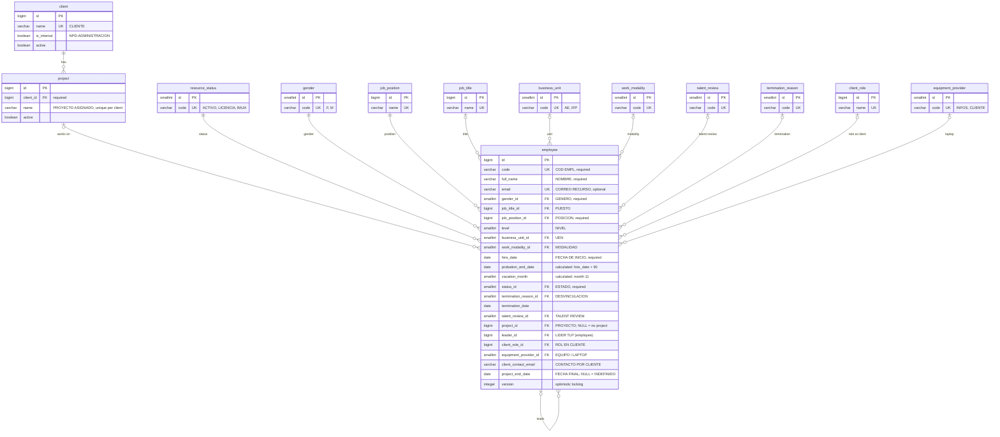

# Database

PostgreSQL 18 schema, versioned with Flyway in [`src/main/resources/db/migration`](../../src/main/resources/db/migration). It models the client's planner (`PLANIFICACION DE RECURSOS NPD`, sheet `PLANIFICADOR`): one `employee` row per collaborator, `project` and `client` as their own tables, and catalogs for repeated values.

| Migration | Content |
|---|---|
| `V1__create_catalogs.sql` | Catalogs, `client` and `project`; seeds the fixed catalogs |
| `V2__create_employee.sql` | `employee` and the `resource_v` view |

Images: [`er-diagram.png`](er-diagram.png). Editable diagram: [`er-diagram.drawio`](er-diagram.drawio) (open at https://app.diagrams.net).

## Entity-relationship model

Every table also has `created_at` and `updated_at` (kept by the `set_updated_at` trigger). Catalogs have `name` (the display text, in Spanish because end users see it) and `active`.

## Rules

- **Projects exist on their own.** A project is created before anyone is placed on it, and stays when it has no employees. A client stays when it has no projects.
- **Required in the database** only where every planner row has the value: code, name, gender, position, hire date and status. Project, NPD lead and work modality are required by the application but nullable in the database, because the planner has rows without them.
- **Everything except client and project name belongs to the employee**: in the planner, lead, end date, client contact, laptop, role, level and modality change from person to person within the same project.
- `email` is optional and unique case-insensitively. `code` is text (`SP11`).
- `probation_end_date` and `vacation_month` are generated from `hire_date`; they match the planner on all its rows.
- Nobody is their own lead; a termination date is not before the hire date; level is greater than zero.
- Concurrent edits are detected with `version` (optimistic locking).

## `resource_v`

Rebuilds the planner, one row per employee, for the roster, the table view and exports. It derives `assignment_situation`:

| Situation | Condition |
|---|---|
| `SIN_PROYECTO` | No project |
| `PENDIENTE_CONFIRMACION` | `project_end_date` has passed and nobody has extended it |
| `ASIGNADO` | Any other case |

## Mapping of the planner columns

| Planner column | Stored in |
|---|---|
| CLIENTE | `project.client_id` → `client` |
| PROYECTO ASIGNADO | `employee.project_id` → `project` |
| LIDER TLP, COD LIDER | `employee.leader_id` → `employee` |
| COD EMPL | `employee.code` |
| NOMBRE DE EMPLEADO | `employee.full_name` |
| PUESTO | `employee.job_title_id` → `job_title` |
| POSICIÓN EN INFOSGROUP | `employee.job_position_id` → `job_position` |
| ROL ACTUAL EN CLIENTE | `employee.client_role_id` → `client_role` |
| NIVEL | `employee.level` |
| FECHA DE INICIO | `employee.hire_date` |
| UEN | `employee.business_unit_id` → `business_unit` |
| GENERO | `employee.gender_id` → `gender` |
| EQUIPO / LAPTOP | `employee.equipment_provider_id` → `equipment_provider` |
| MES DE PROBATORIA | `employee.probation_end_date` (calculated) |
| MES DE VACACIONES | `employee.vacation_month` (calculated) |
| FECHA FINAL PROYECTO | `employee.project_end_date` |
| MES FINAL DE PROYECTO | `resource_v.project_end_month` (calculated) |
| ESTADO | `employee.status_id` → `resource_status` + `resource_v.assignment_situation` |
| Desvinculación en Infosgroup | `employee.termination_reason_id` → `termination_reason` |
| RESULTADO DE TALENT REVIEW | `employee.talent_review_id` → `talent_review` |
| CORREO RECURSO | `employee.email` |
| CONTACTO POR CLIENTE | `employee.client_contact_email` |
| MODALIDAD LABORAL DEL RECURSO | `employee.work_modality_id` → `work_modality` |
