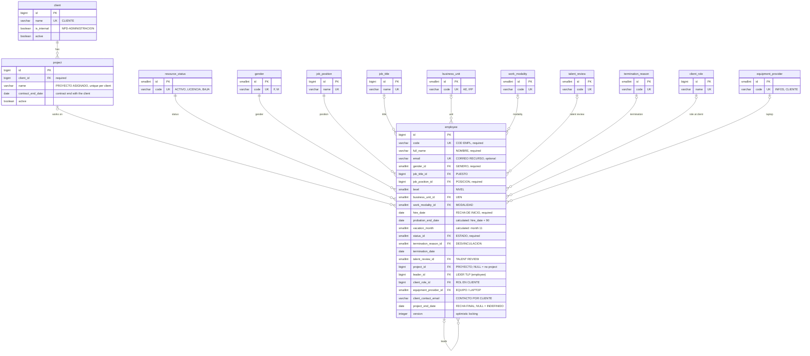

# Database

PostgreSQL 18 schema, versioned with Flyway in [`src/main/resources/db/migration`](../../src/main/resources/db/migration). It models the client's planner (`PLANIFICACION DE RECURSOS NPD`, sheet `PLANIFICADOR`): one `employee` row per collaborator, `project` and `client` as their own tables, and catalogs for repeated values.

| Migration | Content |
|---|---|
| `V1__create_catalogs.sql` | Catalogs, `client` and `project`; seeds the fixed catalogs |
| `V2__create_employee.sql` | `employee` and the `resource_v` view |
| `V3__prepare_planner_import.sql` | "No especificado" values for required fields the planner leaves empty |
| `V4__projects_and_assignment_view.sql` | `project.contract_end_date`; `resource_v` with ids and project dates; `project_summary_v` |
| `V5__create_audit_log.sql` | `audit_log`: who changed what and when, one row per field |
| `V7__resource_search.sql` | `resource_v` with what the roster search needs: probation, client role id, start of the bar, group and search text |

Images: [`er-diagram.png`](er-diagram.png). Editable diagram: [`er-diagram.drawio`](er-diagram.drawio) (open at https://app.diagrams.net).

## Entity-relationship model

Every table also has `created_at` and `updated_at` (kept by the `set_updated_at` trigger). Catalogs have `name` (the display text, in Spanish because end users see it) and `active`.

## Rules

- **One project per person.** `employee.project_id` is the current project; there is no assignment table.
- **Projects exist on their own.** A project is created before anyone is placed on it, and stays when it has no employees. A client stays when it has no projects.
- **A project has its own contract end** (`project.contract_end_date`), distinct from each employee's `project_end_date`. It drives the Sales alert at 30 and 15 days; `NULL` means no date. A project starts the day it is created (`project.created_at`).
- **An employee may have no project** (`project_id` NULL = "Sin proyecto"): allowed when registering a new hire and when someone is removed from a project, which keeps the project.
- **Required in the database** only where every planner row has the value: code, name, gender, position, hire date and status. NPD lead and work modality are required by the application but nullable in the database, because the planner has rows without them.
- **Everything except client and project name belongs to the employee**: in the planner, lead, end date, client contact, laptop, role, level and modality change from person to person within the same project.
- `email` is optional and unique case-insensitively. `code` is text (`SP11`).
- `probation_end_date` and `vacation_month` are generated from `hire_date`; they match the planner on all its rows.
- Nobody is their own lead; a termination date is not before the hire date; level is greater than zero.
- Concurrent edits are detected with `version` (optimistic locking).

## "No especificado" values

The planner has rows where a required field is empty. So the one-time import does not reject them, those rows point to a **"No especificado"** value until someone fills in the real data:

| Field | Value |
|---|---|
| Work modality | `work_modality` with code `NO_ESPECIFICADO` |
| Client and project | `client` "No especificado" and its `project` "No especificado" |

These values are **inactive** (`active = false`): the application must not offer them when creating or editing an employee, so the field stays required for new data. A record that still has one of them must be corrected before it is saved again.

## `resource_v`

Rebuilds the planner, one row per employee, for the roster, the table view and exports. It derives `assignment_situation`:

| Situation | Condition |
|---|---|
| `SIN_PROYECTO` | No project |
| `PENDIENTE_CONFIRMACION` | `project_end_date` has passed and nobody has extended it |
| `ASIGNADO` | Any other case |

Besides the planner columns (names), it exposes ids and project data so the API groups and links without comparing names (a project name is only unique within its client):

| Column | Source | Use |
|---|---|---|
| `project_id`, `client_id` | `employee.project_id`, `project.client_id` | Group the roster by project; link to the project detail |
| `project_active` | `project.active` | Spot the inactive "No especificado" project and ask for a fix |
| `project_start_date` | `project.created_at` | Start of the roster bar |
| `contract_end_date` | `project.contract_end_date` | "Fin de contrato" column and alert |
| `leader_id` | `employee.leader_id` | Filter an NPD lead's collaborators by id |
| `on_probation` | `employee.on_probation` | Draw day 90 of probation on the roster bar |
| `client_role_id` | `employee.client_role_id` | Filter the roster by role in the client |
| `assignment_start_date` | later of `project.created_at` and `employee.hire_date` | Start of the roster bar |
| `roster_group` | 0 = inactive project ("No especificado"), 1 = without project, 2 = active project | Order of the roster groups: the records to fix go first |
| `search_text` | name, employee number, project and client, in lower case without accents | Roster search ("zuniga" finds "Zúñiga") |

## `project_summary_v`

One row per project, with or without team, for the projects list and detail. Employees on Baja are not counted.

| Column | Meaning |
|---|---|
| `project_id`, `client_id`, `client`, `is_internal`, `project`, `active` | The project and its client |
| `start_date` | Day the project was created |
| `contract_end_date` | Contract end with the client |
| `team_size` | Employees on the project; `0` = "Sin equipo" |
| `pending_confirmation` | Team members whose `project_end_date` has passed ("N por confirmar") |
| `next_assignment_end` | Earliest `project_end_date` still to come |
| `indefinite_count` | Team members without `project_end_date` (INDEFINIDO) |

## `audit_log`

Change history of the records written through the API (not of the one-time import). One row per field, only inserted:

| Column | Meaning |
|---|---|
| `entity_type`, `entity_id` | Audited record, for example `employee` and its id |
| `action` | `CREATE` (initial values, `old_value` NULL) or `UPDATE` (only the fields that changed) |
| `field` | Field as the API names it (`workMode`, `assignment.project`...) |
| `old_value`, `new_value` | Values as the user sees them (names, not ids; `Indefinido` for no end date) |
| `actor`, `occurred_at` | `preferred_username` of the Keycloak token, and when |

The audit rows are written in the same transaction as the change, so both are saved or neither is.

## API rules (not enforced by the database)

- **Baja**: termination reason and date are required, and the employee leaves the project (`project_id` = NULL). A `CHECK` cannot read the status code, so the employee service enforces it.
- **Deactivating a project** is only allowed when no active employee is on it.
- **Bulk assignment** updates every employee in one transaction, checking each `version`: if one fails, nobody is assigned.

## Mapping of the planner columns

| Planner column | Stored in |
|---|---|
| CLIENTE | `project.client_id` → `client` |
| PROYECTO ASIGNADO | `employee.project_id` → `project` |
| LIDER TLP, COD LIDER | `employee.leader_id` → `employee` |
| COD EMPL | `employee.code` |
| NOMBRE DE EMPLEADO | `employee.full_name` |
| PUESTO | `employee.job_title_id` → `job_title` |
| POSICIÓN EN INFOSGROUP | `employee.job_position_id` → `job_position` |
| ROL ACTUAL EN CLIENTE | `employee.client_role_id` → `client_role` |
| NIVEL | `employee.level` |
| FECHA DE INICIO | `employee.hire_date` |
| UEN | `employee.business_unit_id` → `business_unit` |
| GENERO | `employee.gender_id` → `gender` |
| EQUIPO / LAPTOP | `employee.equipment_provider_id` → `equipment_provider` |
| MES DE PROBATORIA | `employee.probation_end_date` (calculated) |
| MES DE VACACIONES | `employee.vacation_month` (calculated) |
| FECHA FINAL PROYECTO | `employee.project_end_date` |
| MES FINAL DE PROYECTO | `resource_v.project_end_month` (calculated) |
| ESTADO | `employee.status_id` → `resource_status` + `resource_v.assignment_situation` |
| Desvinculación en Infosgroup | `employee.termination_reason_id` → `termination_reason` |
| RESULTADO DE TALENT REVIEW | `employee.talent_review_id` → `talent_review` |
| CORREO RECURSO | `employee.email` |
| CONTACTO POR CLIENTE | `employee.client_contact_email` |
| MODALIDAD LABORAL DEL RECURSO | `employee.work_modality_id` → `work_modality` |
