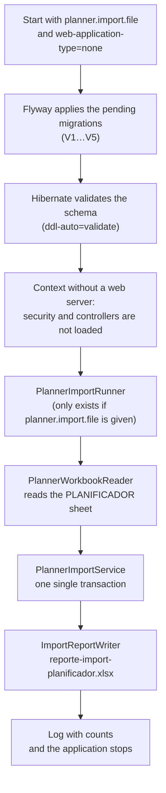

# How to run the planner import

Practical guide: what happens when the import runs and which command to use depending on where you are. The import rules (what is rejected, what is flagged) are in the [README](README.md).

> **The Excel has personal data.** Keep it outside any repository, for example in `C:\Users\<you>\Documents\npd-import\planificador.xlsx`, and never commit it or its report.

## Flow

The import is not an endpoint: it is the same application started in command mode. It starts, imports, writes the report and stops.



1. **Startup.** The application starts with two values:
   - `planner.import.file`: the path of the Excel.
   - `spring.main.web-application-type=none`: start without a web server, so it opens no port and stops when it finishes.

   They can be passed as arguments (`--planner.import.file=…`) or as environment variables (`PLANNER_IMPORT_FILE`, `SPRING_MAIN_WEB_APPLICATION_TYPE`), which is what Docker uses.
2. **Migrations.** Flyway applies the missing migrations and Hibernate checks that the tables match the entities. If the database is empty, the whole schema is created here.
3. **Context without web.** Without a web server, `SecurityConfig` and the 401/403 handler, which carry `@ConditionalOnWebApplication`, are not loaded, and the import does not need Keycloak.
4. **`PlannerImportRunner`.** It only exists when `planner.import.file` is given. Without that property, the application starts normally as the API and imports nothing.
5. **`PlannerWorkbookReader`.**
   - Opens the Excel and reads the `PLANIFICADOR` sheet; if it does not exist, it reads the first one.
   - Looks for the header row (the one with `COD EMPL`) among the first 10 rows.
   - Recognizes each column by its name, so extra columns or a different order do not break it.
6. **`PlannerImportService`.** Everything happens in one single transaction: if something fails, nothing is saved.
   - Cleans the values.
   - Creates the missing clients, projects and catalogs.
   - Creates or updates each employee by `COD EMPL`.
   - Assigns the leaders at the end, when every employee exists.

   Running it again updates the data; it does not duplicate it.
7. **`ImportReportWriter`.**
   - Writes `reporte-import-planificador.xlsx` in the Excel's folder, with the sheets Resumen, Rechazadas and Observaciones.
   - For another path, use `planner.import.report` (`PLANNER_IMPORT_REPORT` in Docker).
8. **End.** The log only shows counts, never personal data, and the application stops:
   ```
   Planner import finished: 162 rows read, 162 imported, 0 rejected, 37 flagged. Report: …
   ```

The import does not write to `audit_log`, because the audit only records the changes made through the API.

Code: [`planner/importer`](../../src/main/java/com/npdinfosgroup/api/planner/importer).

## In this repository (NPD-RP-Backend)

You need Docker Desktop running. The commands run from the root of the repo and are written for PowerShell.

### With Maven (the application on your machine)

`spring-boot-docker-compose` starts only the `postgres` service of `compose.yaml`:

```powershell
./mvnw spring-boot:run "-Dspring-boot.run.arguments=--spring.main.web-application-type=none --planner.import.file=C:/Users/<you>/Documents/npd-import/planificador.xlsx"
```

Use `/` in the path. If the path has spaces, move the Excel to a folder without spaces.

### With Docker (the application in a container)

It uses the same image as `docker compose up`. Run `build` every time the code changes:

```powershell
docker compose build api
docker compose run --rm `
  -v C:/Users/<you>/Documents/npd-import:/import `
  -e PLANNER_IMPORT_FILE=/import/planificador.xlsx `
  -e SPRING_MAIN_WEB_APPLICATION_TYPE=none `
  api
```

- `-v` mounts the Excel's folder on `/import`. The report ends up in that same folder on your machine.
- `run --rm` creates a single-use container, deleted when it finishes. It starts Postgres if needed.

Then, to use the API with the imported data:

```powershell
docker compose up -d
```

Both paths, Maven and Docker, use the same database: this repo's `pgdata` volume, published on `localhost:5433`.

## In the infra repository (global docker-compose)

From the folder that has `docker-compose.yaml` (`SUCCESS/`). There the service is called `backend`, not `api`:

```powershell
docker compose build backend
docker compose run --rm `
  -v C:/Users/<you>/Documents/npd-import:/import `
  -e PLANNER_IMPORT_FILE=/import/planificador.xlsx `
  -e SPRING_MAIN_WEB_APPLICATION_TYPE=none `
  -e SPRING_FLYWAY_LOCATIONS=classpath:db/migration `
  backend
```

`SPRING_FLYWAY_LOCATIONS=classpath:db/migration` is needed because of how the global compose is today:

- **The infra migrations folder is empty.** The global compose makes the backend read the migrations from `SUCCESS/db/migration`, which is empty. The migrations live in the backend (`src/main/resources/db/migration`), and this variable tells it to use those.
- **The infra database may have an old schema.** If your `success_pgdata` volume was created with an earlier design (`2 - create employee and assignment` in `flyway_schema_history`), Flyway cannot validate it and the backend does not start. Delete only that volume, which **deletes the data of the infra database**:
  ```powershell
  docker compose stop
  docker volume rm success_pgdata
  ```
  Do not use `docker compose down -v`: it also deletes `keycloak-data`, with Keycloak's users and configuration.

To start everything, frontend included, with the imported data, `backend` needs the same variable. Until the global compose is fixed, pass it with an override. Example of a `docker-compose.override.yaml` next to the global one:

```yaml
services:
  backend:
    environment:
      SPRING_FLYWAY_LOCATIONS: classpath:db/migration
```

```powershell
docker compose up -d --build
```

> Do not run both stacks at the same time: both publish Postgres on port 5433 and the API on 8080. Before using one, run `docker compose stop` in the other.

## Production (Railway)

There is no staging environment: only production runs on Railway. The Excel is not uploaded to Railway. The import runs from your machine against the remote database:

1. In Railway, turn on the Postgres **TCP Proxy** (*Settings → Networking*) and write down the public host and port.
2. Check out the commit deployed in production (`main`). Flyway applies on startup the migrations it finds, so with another branch you would change the production schema.
3. Build the jar and run it with the connection in environment variables. The jar does not include `spring-boot-docker-compose`, so it starts no local Postgres:
   ```powershell
   ./mvnw package -DskipTests
   $env:DB_HOST="xxx.proxy.rlwy.net"; $env:DB_PORT="12345"; $env:DB_NAME="railway"; $env:DB_USER="postgres"; $env:DB_PASSWORD="…"
   java -jar target/api-0.0.1-SNAPSHOT.jar --spring.main.web-application-type=none --planner.import.file=C:/Users/<you>/Documents/npd-import/planificador.xlsx
   ```
4. Check the report and turn off the TCP Proxy.

Try it first on your local database (see [In this repository](#in-this-repository-npd-rp-backend)).
