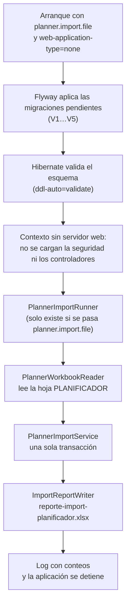

# Cómo ejecutar la importación del planificador

Guía práctica: qué pasa cuando se ejecuta la importación y qué comando usar según dónde estés. Las reglas de la importación (qué se rechaza, qué se marca) están en el [README](README.md).

> **El Excel tiene datos personales.** Guárdalo fuera de cualquier repositorio, por ejemplo en `C:\Users\<tú>\Documents\npd-import\planificador.xlsx`, y no hagas commit ni de él ni de su reporte.

## Flujo

La importación no es un endpoint: es la misma aplicación arrancada en modo comando. Arranca, importa, escribe el reporte y se detiene.



1. **Arranque.** La aplicación arranca con dos valores:
   - `planner.import.file`: la ruta del Excel.
   - `spring.main.web-application-type=none`: arrancar sin servidor web, así no abre puerto y se detiene al terminar.

   Se pueden pasar como argumentos (`--planner.import.file=…`) o como variables de entorno (`PLANNER_IMPORT_FILE`, `SPRING_MAIN_WEB_APPLICATION_TYPE`), que es lo que se usa con Docker.
2. **Migraciones.** Flyway aplica las migraciones que falten y Hibernate valida que las tablas coincidan con las entidades. Si la base está vacía, aquí se crea el esquema completo.
3. **Contexto sin web.** Sin servidor web no se cargan `SecurityConfig` ni el manejador de 401/403, que llevan `@ConditionalOnWebApplication`, y la importación no necesita Keycloak.
4. **`PlannerImportRunner`.** Solo existe cuando se pasa `planner.import.file`. Sin esa propiedad, la aplicación arranca normal como API y no importa nada.
5. **`PlannerWorkbookReader`.**
   - Abre el Excel y lee la hoja `PLANIFICADOR`; si no existe, lee la primera.
   - Busca la fila de encabezados (la que tiene `COD EMPL`) entre las 10 primeras filas.
   - Reconoce cada columna por su nombre, así que columnas extra o en otro orden no la rompen.
6. **`PlannerImportService`.** Todo pasa en una sola transacción: si algo falla, no se guarda nada.
   - Limpia los valores.
   - Crea los clientes, proyectos y catálogos que falten.
   - Crea o actualiza a cada empleado por `COD EMPL`.
   - Asigna los líderes al final, cuando ya existen todos los empleados.

   Ejecutarla otra vez actualiza los datos; no los duplica.
7. **`ImportReportWriter`.**
   - Escribe `reporte-import-planificador.xlsx` en la carpeta del Excel, con las hojas Resumen, Rechazadas y Observaciones.
   - Para otra ruta se usa `planner.import.report` (`PLANNER_IMPORT_REPORT` en Docker).
8. **Fin.** El log solo muestra conteos, nunca datos personales, y la aplicación se detiene:
   ```
   Planner import finished: 162 rows read, 162 imported, 0 rejected, 37 flagged. Report: …
   ```

La importación no escribe en `audit_log`, porque la auditoría registra solo los cambios hechos por la API.

Código: [`planner/importer`](../../src/main/java/com/npdinfosgroup/api/planner/importer).

## En este repositorio (NPD-RP-Backend)

Necesitas Docker Desktop encendido. Los comandos se ejecutan desde la raíz del repo y están escritos para PowerShell.

### Con Maven (la aplicación en tu máquina)

`spring-boot-docker-compose` levanta solo el servicio `postgres` de `compose.yaml`:

```powershell
./mvnw spring-boot:run "-Dspring-boot.run.arguments=--spring.main.web-application-type=none --planner.import.file=C:/Users/<tú>/Documents/npd-import/planificador.xlsx"
```

Usa `/` en la ruta. Si la ruta tiene espacios, mueve el Excel a una carpeta sin espacios.

### Con Docker (la aplicación en un contenedor)

Usa la misma imagen que `docker compose up`. Haz `build` cada vez que cambie el código:

```powershell
docker compose build api
docker compose run --rm `
  -v C:/Users/<tú>/Documents/npd-import:/import `
  -e PLANNER_IMPORT_FILE=/import/planificador.xlsx `
  -e SPRING_MAIN_WEB_APPLICATION_TYPE=none `
  api
```

- `-v` monta la carpeta del Excel en `/import`. El reporte queda en esa misma carpeta de tu equipo.
- `run --rm` crea un contenedor de un solo uso, que se borra al terminar. Si hace falta, levanta Postgres.

Después, para usar la API con los datos importados:

```powershell
docker compose up -d
```

Los dos caminos, Maven y Docker, usan la misma base: el volumen `pgdata` de este repo, publicado en `localhost:5433`.

## En el repositorio de infra (docker-compose global)

Desde la carpeta que tiene `docker-compose.yaml` (`SUCCESS/`). Ahí el servicio se llama `backend`, no `api`:

```powershell
docker compose build backend
docker compose run --rm `
  -v C:/Users/<tú>/Documents/npd-import:/import `
  -e PLANNER_IMPORT_FILE=/import/planificador.xlsx `
  -e SPRING_MAIN_WEB_APPLICATION_TYPE=none `
  -e SPRING_FLYWAY_LOCATIONS=classpath:db/migration `
  backend
```

`SPRING_FLYWAY_LOCATIONS=classpath:db/migration` es necesario por cómo está hoy el compose global:

- **La carpeta de migraciones de infra está vacía.** El compose global hace que el backend lea las migraciones de `SUCCESS/db/migration`, que está vacía. Las migraciones viven en el backend (`src/main/resources/db/migration`), y esta variable le dice que use esas.
- **La base de infra puede tener un esquema viejo.** Si tu volumen `success_pgdata` se creó con un diseño anterior (`2 - create employee and assignment` en `flyway_schema_history`), Flyway no puede validarlo y el backend no arranca. Hay que borrar solo ese volumen, lo que **elimina los datos de la base de infra**:
  ```powershell
  docker compose stop
  docker volume rm success_pgdata
  ```
  No uses `docker compose down -v`: también borra `keycloak-data`, con los usuarios y la configuración de Keycloak.

Para levantar todo, incluido el frontend, con los datos importados, `backend` necesita la misma variable. Mientras el compose global no se corrija, pásala con un override. Ejemplo de `docker-compose.override.yaml` junto al global:

```yaml
services:
  backend:
    environment:
      SPRING_FLYWAY_LOCATIONS: classpath:db/migration
```

```powershell
docker compose up -d --build
```

> No ejecutes los dos stacks a la vez: los dos publican Postgres en el puerto 5433 y la API en el 8080. Antes de usar uno, ejecuta `docker compose stop` en el otro.

## Staging y producción (Railway)

El Excel no se sube a Railway. La importación se ejecuta desde tu equipo contra la base remota:

1. En Railway, activa el **TCP Proxy** del Postgres (*Settings → Networking*) y anota el host y el puerto públicos.
2. Ve al mismo commit desplegado en ese entorno (`develop` para staging, `main` para producción). Flyway aplica al arrancar las migraciones que encuentre, así que con otra rama cambiarías el esquema de ese entorno.
3. Genera el jar y ejecútalo con la conexión en variables de entorno. El jar no incluye `spring-boot-docker-compose`, así que no levanta ningún Postgres local:
   ```powershell
   ./mvnw package -DskipTests
   $env:DB_HOST="xxx.proxy.rlwy.net"; $env:DB_PORT="12345"; $env:DB_NAME="railway"; $env:DB_USER="postgres"; $env:DB_PASSWORD="…"
   java -jar target/api-0.0.1-SNAPSHOT.jar --spring.main.web-application-type=none --planner.import.file=C:/Users/<tú>/Documents/npd-import/planificador.xlsx
   ```
4. Revisa el reporte y cierra el TCP Proxy.

Pruébalo primero en staging.
